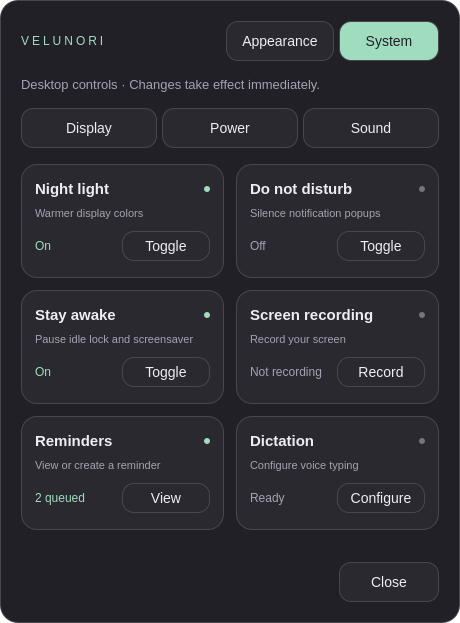

# Velunori

A floating desktop shell for Omarchy. One visual language, two bar layouts.

- **Island** groups your existing widgets in a centered capsule.
- **Orbit** separates left, center and right widgets into floating capsules.
- Appearance settings include drawn previews, live desktop preview, independent
  Lavender / Mint / Pearl accents, and Apply / Cancel.
- Existing widget order and settings remain in Omarchy's `bar.layout`.
- Built-in workspaces use dots and an accent pill for the active workspace.
- The anchored Control Center has an Appearance tab and a System tab for night light, do not
  disturb, stay awake, screen recording, reminders and dictation configuration.
  The legacy hover-to-reveal indicator strip is hidden on every monitor while
  Velunori is active. Its saved configuration is preserved for other bars.
- Display, power and sound move from separate bar icons to Control Center
  shortcuts. Their existing Omarchy panels remain available, anchored at the
  Control Center button on the relevant monitor.


## Status

Early local implementation, targeting the plugin API installed with **Omarchy
4.0.6-1**. No system update is required to start testing on that version.
Settings have been exercised headlessly. The full bar still needs an interactive
Wayland session check before this can be considered a release.
The installed Quickshell build has a known scanner-race signature matching the
observed crash. See [stability status](docs/stability.md) for the evidence,
import fixes, checks and remaining host-package blocker.
Headless checks cover settings lifecycle, normalization and collision thresholds,
plus QML lint. They do not verify layer-shell placement, input masks, shell IPC
or persistence through the real host. The restricted development environment
reports an expected IPC-socket error during the headless UI check.

## Local development

Keep the checkout at `~/dev/Velunori/core`. From a terminal in that directory:

```bash
bash scripts/check.sh
bash scripts/install-local.sh
```

The installer backs up `shell.json`, links this checkout into
`~/.config/omarchy/plugins/velunori.core`, and enables the replacement bar.
It refuses to overwrite another installation. No packaged Omarchy files change.
The shell watches plugin source for changes.

Click the **settings icon** to open Control Center on that monitor, or run:

```bash
omarchy-shell velunori settings
```

IPC opens it on the focused monitor. Escape, outside click and clicking its
button again dismiss it. Opening another panel closes it. Appearance preview
is discarded on dismissal unless Apply was used. The desktop does not open a
separate settings window; `SettingsWindow.qml` is only a headless preview harness.

Selecting a card previews that layout immediately. Apply persists it; Cancel,
Escape, or closing the window discards the preview. Settings live under
`bar.velunori` in `shell.json`:

```json
{ "style": "island", "accent": "lavender", "motion": true }
```

System controls act immediately, independently of Apply/Cancel for appearance.
The first three switches use Omarchy's live service state. Recording, reminders
and dictation launch the same flows as the former indicator buttons; launching
one closes Settings. Status probes run only while the System tab is visible.



## Return to the original bar

```bash
omarchy plugin enable omarchy.bar
```

This keeps the widget layout and your Velunori preferences. A complete
pre-installation configuration backup is printed by the installer.

## Current scope

Top and bottom bars, one per monitor. A previously configured side bar renders
at the top while Velunori is active. Orbit falls back to a joined capsule when
the sections would overlap; oversized contents can be dragged horizontally.
The existing center widget group is centered as a group, rather than pinning
one widget via `centerAnchor`.

Existing widget popups and notifications retain their current Omarchy styling.
Application themes, wallpaper and window decorations are outside this first
implementation. The concept images describe the longer-term visual direction.
Compatibility of third-party widgets that require private services needs a
live session check: replacement bars receive narrower host capabilities.

## Shared design foundation

`design/Tokens.qml` defines semantic colors, spacing, radii and bar dimensions.
`components/` contains the initial reusable controls and layout previews.
Feature plugins import the public `kit/` API from the sibling installation
directory `velunori.core`. The clock is the first consumer. See
[design kit v1](docs/kit-v1.md) for the contract, installation paths and
compatibility rules. `components/` and `design/` are internal implementation
details; feature plugins should use `kit/`.

The widget host is derived from Omarchy's MIT-licensed bar to preserve its
loader, widget APIs, drag ordering, popout coordination and tooltips. See
[third-party notices](THIRD_PARTY_NOTICES.md) for provenance.
