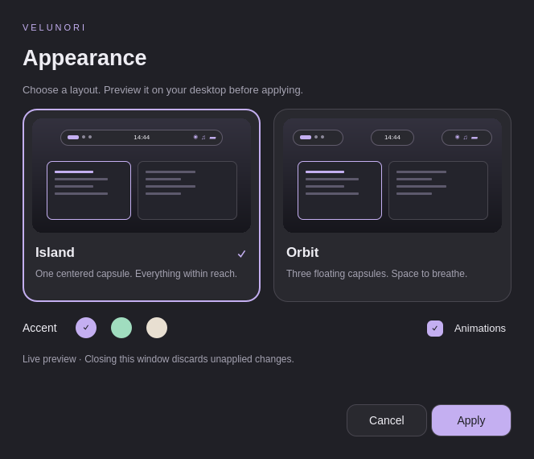

# Velunori

> A floating bar for Omarchy in two layouts, with the design kit every other Velunori plugin is built on.


## Features

- **Island** groups your existing widgets in one centred capsule; **Orbit** splits left, centre and right into three floating capsules.
- Appearance settings with drawn previews, a live preview on the desktop, three accents (Lavender, Mint, Pearl), an animation switch, and Apply / Cancel.
- Your widget order and widget settings stay in Omarchy's own `bar.layout`; switching back to the original bar keeps them.
- Built-in workspaces are drawn as dots with an accent pill for the active one.
- A design kit (`kit/`) with the theme, panel, buttons, toggles and sliders that the other Velunori plugins import.

## Requirements

Omarchy with the shell plugin API. Developed against **Omarchy 4.0.6-1**.

## Install

```bash
bash ~/dev/Velunori/core/scripts/install-local.sh
```

The installer backs up `shell.json`, links this checkout into `~/.config/omarchy/plugins/velunori.core` and enables the bar. It refuses to overwrite another installation and changes no packaged Omarchy files.

Return to the original bar at any time; the widget layout and your Velunori preferences are kept:

```bash
omarchy plugin enable omarchy.bar
```

## Use

Click the settings icon in the bar, or run `omarchy-shell velunori settings`. With Control Center installed the icon opens it; without it, the icon opens the appearance editor. Selecting a layout previews it immediately. Apply saves it; Cancel, Escape or closing the panel discards the preview.

Settings are stored under `bar.velunori` in `shell.json`:

```json
{ "style": "island", "accent": "lavender", "motion": true }
```

## Screens

| Appearance | System |
| --- | --- |
|  |  |

## For plugin authors

Feature plugins import `kit/` from the sibling directory `velunori.core`. `components/` and `design/` are internal. The contract, installation paths and compatibility rules are in [docs/kit-v1.md](docs/kit-v1.md).

`scripts/compose-preview.sh <screenshot> <docs/preview.png>` produces the preview image used at the top of every Velunori README.

## Development

```bash
bash scripts/check.sh
```

Checks cover the settings lifecycle, normalisation, collision thresholds and QML lint. They run headlessly and do not verify layer-shell placement, input masks, shell IPC or persistence through the real host; those need a look in the desktop session.

## Limits

- Top and bottom bars, one per monitor. A side bar configured earlier is drawn at the top while Velunori is active.
- Orbit falls back to a joined capsule when its sections would overlap; oversized contents can be dragged horizontally.
- Third-party widgets that need private host services may behave differently, because replacement bars receive narrower capabilities from Omarchy.
- The installed Quickshell build has a known scanner race that can crash the shell. The evidence and the remaining host-package blocker are in [docs/stability.md](docs/stability.md).

## Velunori plugins

Velunori is a set of independent plugins for the [Omarchy](https://omarchy.org) shell. Install only the ones you want; each lives in its own repository and can be removed without touching the others.

| Plugin | What it is |
| --- | --- |
| **core** (this repository) | The Island and Orbit bars, the appearance settings and the shared design kit |
| [clock](https://github.com/velunori/clock) | Clock in the bar with a month calendar |
| [control-center](https://github.com/velunori/control-center) | Sound, displays, network, capture and reminders in one panel |
| [notifications](https://github.com/velunori/notifications) | Notification cards and a session history |
| [menu](https://github.com/velunori/menu) | The Omarchy command menu as a two-pane panel |
| [update](https://github.com/velunori/update) | A window for `omarchy update` with release notes and live progress |
| [weather](https://github.com/velunori/weather) | Weather in the bar with a forecast panel |

## License

MIT, see [LICENSE](LICENSE). The widget host is adapted from Omarchy's MIT-licensed bar; see [THIRD_PARTY_NOTICES.md](THIRD_PARTY_NOTICES.md).
